<div align="center">

# StarGod Portfolio v0.123.0

**I build things I actually see.**

[Explore StarGod](https://henry-nugraha.pages.dev/) · [Project library](https://henry-nugraha.pages.dev/projects) · [Credential library](https://henry-nugraha.pages.dev/credentials)

<picture>
  <source media="(prefers-reduced-motion: reduce)" srcset="public/assets/readme/universe-poster.webp" />
  <source type="image/webp" srcset="public/assets/readme/living-universe.webp" />
  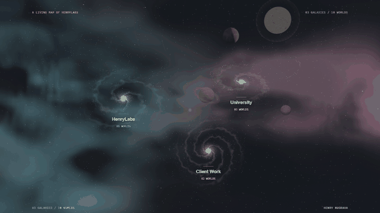
</picture>

**StarGod** is Henry Nugraha's universe of products, client systems, and things built while learning.
Designed and developed by **Henry Nugraha**, a product-minded developer in Indonesia.

The universe handoff uses a bounded Lenis + GSAP scroll driver, so the opening resolves into HenryLabs and the headline hero before the living map takes over, without competing with native browser scrolling.

[The Worlds](#the-worlds) · [University](#university) · [Client Work](#client-work) · [Credentials](#credentials) · [Contact](#contact)

[View the still image](public/assets/readme/universe-poster.webp)

</div>

## The Experience

Three galaxies. Ten project worlds. One maker.

The opening behaves like a real Three.js camera searching a spherical multiverse: 128 universe signatures sit at different depths, a layered star field opens from deep indigo into a denser cosmic scale, and bounded near-camera stars cross the lens during the approach. The chosen StarGod signal then travels through four readable authored scales: **Universe**, **Laniakea** with 17 superclusters, **Local Group** with 61 galaxies, and the **HenryLabs galaxy** with five project worlds. The centered progress line shows the search percentage and the route stays visible while the camera locks to the destination. The UFO and scout begin only after that handoff to the “I build things I actually see.” galaxy opening, so the arrival story has a clear before and after. This hierarchy is a visual portfolio atlas, not a scientific reconstruction of the observable universe.

The living map is backed by a procedural volumetric nebula: layered filaments, distant stellar depth, and a slow parallax drift keep the sky feeling like space rather than a flat backdrop while the project systems remain readable.

The opening sky has smoother volumetric sampling, clearer cool emission lanes and depth-weighted starlight. Its sun uses warmer, broader surface detail and a soft corona, with local light protection behind the headline and galaxy names. This lighting settles back into the established reading sky when the map departs; the intro and black-hole sequence keep their existing appearance.

The opening headline recedes with the scroll position as the galaxy map approaches. Scrolling back retraces the same reveal. A softer reading veil keeps the headline clear without covering the surrounding nebula, and the map holds a brighter sky throughout its exploration window. The selected-project preview settles before reaching the viewport center, with text at full opacity from the start.

The opening lettering has a shallow sculpted edge and a restrained response to a nearby mouse. It remains selectable, semantic text rather than a mesh. Galaxy names follow their actual camera depth while the buttons keep steady touch and keyboard targets. Touch, Still, and reduced motion preserve the lettering without the tilt. Paragraphs and controls remain flat and steady.

Each selected project has a bookmarkable place in the universe. Reloading, returning from a project, or using browser Back restores that world with its reading panel closed. Detail pages bring build state, ownership and access forward, followed by a three-step explanation of the existing workflow. Public source, concept artwork and private walkthroughs remain clearly distinguished.

After arrival, sparse nearby stars pass the camera around the opening headline. Their perspective grows as they approach, with a gentle increase in pace during scrolling or Explore. They fade before recycling, yield to the interactive map, and continue around protected reading areas before handing over to Contact's gravity flow. The distant sky remains independent; this is not a continuous warp tunnel. Still mode removes these passages while preserving the universe.

StarGod is the working name of the universe, drawn from Henry's longtime alias. **HenryLabs** remains its personal-project galaxy. An authored stellar-orbit mark connects the header, quiet entrance, maker signature, and footer.

Enter a living map of **HenryLabs**, **University**, and **Client Work**. Choose a galaxy, follow a curved camera approach into its planets, and explore the work behind each identity. The active galaxy and planet keep a restrained halo, readable label, and selected state while pointer and keyboard focus reveal the same target. The camera eases through a moving focus point when changing sectors, so the scene does not jump to a new center. Returning retraces that journey without rebuilding the scene. Explore the universe lands in a stable, fully visible exploration window, with space to browse before the camera recedes. The opening headline stays free of project overlays when scrolling back up. Technologies orbit the projects they belong to; an optional reading panel shares the same layout across all ten worlds, with context, ownership, workflow, and technology. It stays closed until requested. Read a project in detail or close the panel to return to the orbit, with keyboard focus preserved throughout.

Beyond the map: one preview following the selected project, then Henry himself. The selected world hands off through a small worldline marker before its clearly labeled artwork preview opens large, zooms, pans, and returns to the reading flow without pretending artwork is an app screenshot. The preview media and facts arrive with a restrained depth offset, then a quiet orbit signal carries the eye toward the maker chapter. A crowned StarGod portrait opens locally under the cursor to reveal Henry in a dark suit: sunglasses, clear glasses, then his unobscured face. The approved portraits share one composition; this is a layered photographic reveal, not a rotatable head model. Four appearance controls also work with touch, keyboard, or reduced motion.

Twenty-five technologies surround the portrait as lit 3D satellites. Scroll through **Build, Interface, Systems, then All**, or choose a group directly. Orbital traces follow the satellites' actual depth and pass behind the portrait, with one, two or three lanes depending on the group. Drag left or right to turn the orbit with momentum; arrow controls offer the same motion without dragging. Tools pass in front of and behind Henry with depth-aware contrast and larger touch targets; back labels yield to the portrait rather than appearing across his face. Select a tool to see the projects that use it. Scroll further and the orbit recedes earlier, while the five featured credentials arrive together with a longer reading hold around the same anchored figure. A thin horizon signal leads that exchange before the credential cards settle. Larger phone captions have their own quiet reading surface, and each credential can open in the shared watermarked viewer. This exchange also works in tablet and phone windows. Short landscape screens and reduced motion retain a readable sequence. Rotating the screen or switching Motion/Still keeps the current technology group or credential reading position in view. Home no longer repeats a separate technology chapter and certificate shelf; the full collections live in their own libraries.

A continuous Three.js universe connects the journey, from distant stars and nebulae to a reversible black-hole encounter at Contact. Natural background planets remain in orbit throughout the reading sections, moving into a smaller peripheral composition rather than disappearing; all five selected worlds now carry readable local moonlets with varied orbital speeds and live orbit traces. A metallic UFO and its pursuing scout add a small story along the way: banking through real depth, tight near-miss tracer shots, a luminous wormhole, the UFO entering first, and the scout following. After the portal closes, thirty quiet seconds pass before the next encounter. The scene pauses outside its clear flight areas and respects reduced motion.

Prefer a closer read? **Projects** opens a searchable catalog of all ten worlds, filtered by HenryLabs, University, or Client Work. Each planet and catalog record leads to the same project detail, with ownership, workflow, stack, and honest access boundaries. Continue to the previous or next project within the same galaxy or filtered selection, or return to the universe from that planet; its reading panel stays closed until requested.

Technology group buttons move to their matching scroll chapter instead of changing only the visible icons. Wheel, touch and keyboard input can interrupt the movement. Foreground orbit paths leave the face clear for scanning, and empty detail space no longer blocks the appearance controls.

The selected world continues into an unframed project preview, with original-proportion artwork and readable ownership, status and evidence. Translucent technology shells share the universe's depth while keeping each logo and its reading controls distinct.

Near-camera stars continue through project reading, technologies and credentials. Scrolling carries them through depth around protected text and portrait areas, before they yield to the black hole's flow at Contact. Still mode keeps the reading experience quiet.

Local stars caught by the black hole complete their spiral instead of lingering near its edge. Dust keeps circulating between planet arrivals, while the distant sky stays independent. Reversing the scroll restores the same local field.

**Credentials** is a separate library of all 37 learning records. Filter by issuer or type, search a title, and open a full-size watermarked preview with zoom and available PDF previews. Browse the current selection without closing the viewer; Home keeps its gallery limited to the five featured records. Arrow keys move between documents at fitted size and pan the image when zoomed. A small preview remains visible while the full-size image loads, with a retry option on failure. English/Indonesian and motion choices travel with the internal links.

Zoomed artwork and certificates can be dragged directly with a mouse or pen. Touch retains native scrolling and pinch zoom; keyboard panning, Fit, Escape, and focus return remain available. Inspection never moves the universe behind the viewer, and certificate watermarks stay embedded in the public images.

The libraries stay inside the same volumetric nebula, with subtle cursor and scroll parallax behind a quieter reading surface. Project identities sit beside their names, with category counts following the search and artwork clearly labeled. Credentials separate issuer, record type, title and date; the full-preview control stays outside the document image. Reading links remember their origin: a project opened from a technology returns to that selected tool and group, the credential library returns to Home's featured credentials, and catalog details return to their filtered project card. Browser Back follows the same reading context. Direct library visits still offer the universe. Reduced motion freezes the sky and loading indicators; interrupted graphics can recover without reloading the page. A missing thumbnail preserves its space and does not block project details or the full certificate viewer.

English is the default, with Indonesian available throughout the main experience. Keyboard navigation, touch controls, reduced motion, and a WebGL fallback keep the work accessible.

Navigation steps out of view as you scroll down, leaving more room for the universe. Scroll up to bring it back. It remains visible while using the mobile menu or navigating its controls by keyboard, across Home, Projects, and Credentials.

The nebula is a sampled 3D density field with illuminated filaments and darker rifts, accompanied by fine stars and occasional brighter glints. At Contact, a dark void interrupts the sky, framed by a flowing accretion disk and bent far-side light. Feeding grains and wisps arrive from above, below, left, and right. Their winding paths contract through several sides of the black-hole horizon rather than streaming toward one visible entry point. Scroll back to retrace the encounter; distant stars stay beyond the pull. These are authored visual interpretations, not a scientific gravity simulation or photographic astronomy assets.

The animation above is a short recording of the actual portfolio, not a concept render. It focuses on the orbit experience and predates the StarGod naming and dedicated reading libraries. The live experience is interactive; the README is a preview. Explore the current version at [henry-nugraha.pages.dev](https://henry-nugraha.pages.dev/).

## The Worlds

<details>
<summary><strong>A closer look at the project orbits</strong></summary>

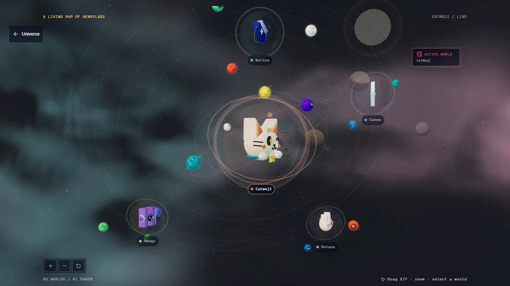

Original project marks become transparent three-dimensional identities. Select a world to bring it into focus, follow its technology satellites, and open its context when you want to read.

</details>

| World | What I Built | Explore |
| :-- | :-- | :-- |
| 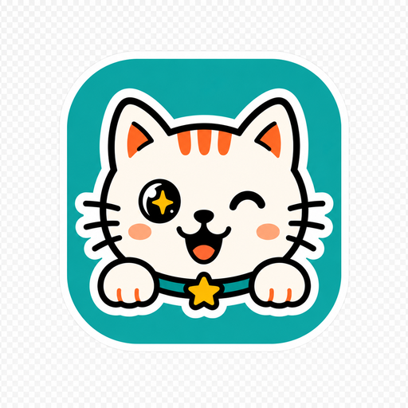 **Catmoji** | Hand gestures become emotions, cat stickers, and voice in a playful browser experience. | [Live product](https://catmoji.vercel.app/) · [Source](https://github.com/nugrahahenry/AI-Gesture-Cat) |
|  **Nalira** | An audio-to-knowledge workflow for lectures, meetings, and ideas worth revisiting. | [Public MVP](https://nalira-hengs.vercel.app/dashboard) |
| 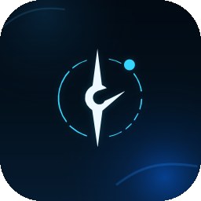 **Canox** | A personal AI cockpit connecting tools, context, and everyday workflows. | Private walkthrough |
| 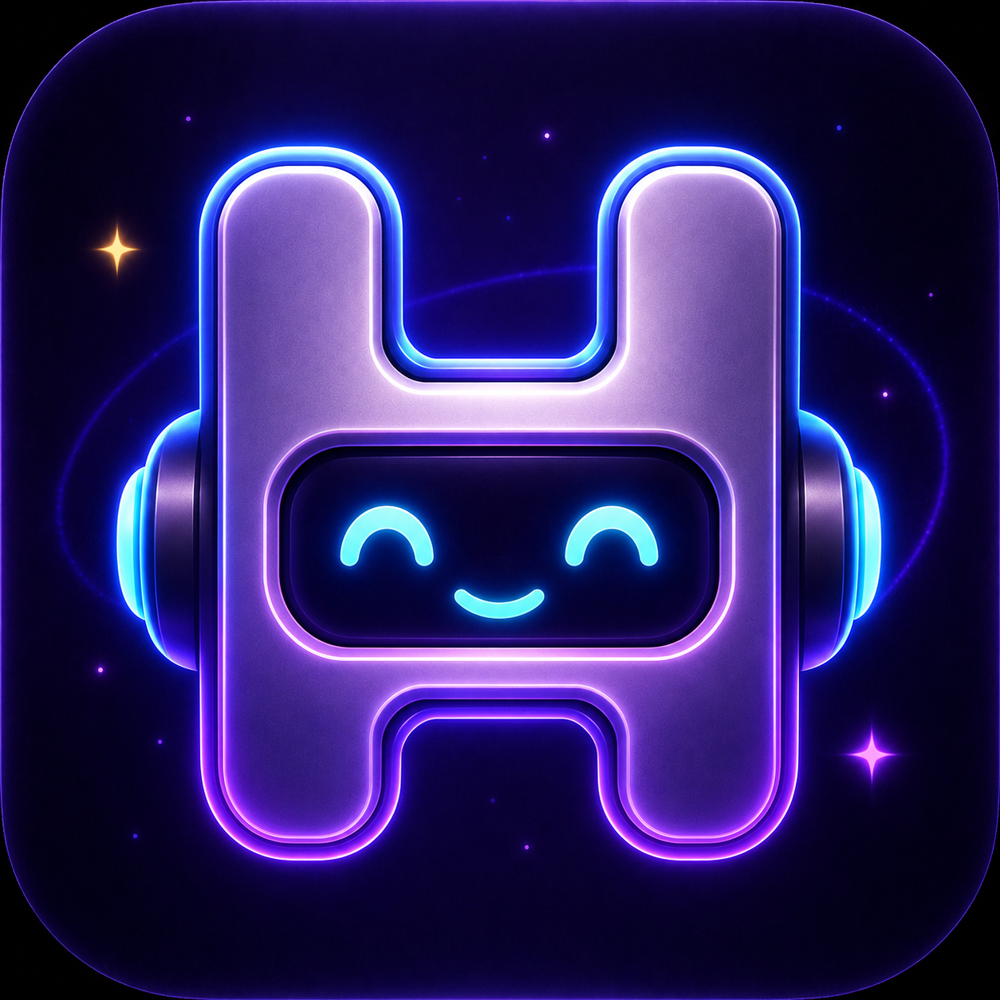 **Hengs** | A WhatsApp focus assistant and Discord community bot built around useful handoffs. | Private evidence |
| 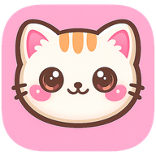 **Polara** | A browser photobooth where the interface becomes part of the memory. | [Live product](https://polara.vercel.app/) |

These are solo product and system builds. Public repositories are linked where available; private work is represented through sanitized evidence and focused walkthroughs.

### Inside Catmoji

Catmoji's project page follows the gesture from hand landmarks to a smoothed
classification and a Moji response. Normal and Challenge previews are actual
application panels, with keyboard-accessible tabs and full-size inspection.
The case study explains the 2,460-sample kNN model, Challenge timing, browser
vision and separate voice path, without claiming measured emotion or accuracy.

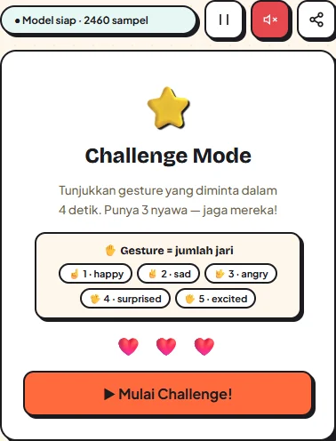

These are cropped Catmoji v1.9.1 screenshots with the camera off, not generated
mockups or recognition results. A real-camera recording is not included yet.
The three optimized WebPs total less than 60 KB; their source revision and crop
are recorded in `public/assets/projects/catmoji/capture.json`. The optional
`scripts/capture-catmoji.mjs` reads a clean sibling checkout, uses the product's
camera-free preview and never calls the voice service. No sibling checkout,
camera, model or third-party service is loaded by the portfolio page.

### Inside Polara

Polara's project detail pairs a short recording of the actual application with
enlargeable desktop and mobile screenshots. The story follows three decisions:
keep photos in the browser session, make retakes and framing reversible, and use
the same geometry in the preview and exported PNG. The captures use Polara
v1.1.3's explicit Demo mode with fictional sample photos, not a visitor's camera.
The recording loads only when played; a text walkthrough and screenshots remain
available without playback. Artwork on the Home preview and catalog stays labeled
as artwork.

The video keeps its desktop framing through the final saved result, with a short
closing hold. Mobile screenshots are captured separately, never by resizing the
recorded session.

Capture provenance lives alongside the public media in
[`capture.json`](public/assets/projects/polara/capture.json). The optional
[`capture-polara.mjs`](scripts/capture-polara.mjs) script records a clean local
Polara checkout using Playwright/Chrome and FFmpeg; it never grants camera access
or changes that checkout. Set `POLARA_ROOT`, `CHROME_PATH`, and `FFMPEG_PATH` for
your local tools. Screenshot export uses the Sharp dependency included with Next.
The portfolio itself does not need the Polara repository to build or run.

## University

Three projects I built end to end, from the business flow to the interface and system logic.

| Project | Course | Focus |
| :-- | :-- | :-- |
| **RentalMobil.SG** | Semester 2, Object-Oriented Programming | Car rental workflows with PHP and MySQL. |
| **POS Z Shoes** | Semester 3, Business Process Analysis and System Design | Point-of-sale workflows with C# and WinForms. |
| **LabQ** | Semester 4, Mobile and Web Programming | Health laboratory workflows across Android and web, using Java, Laravel, and PostgreSQL. |

### Inside RentalMobil.SG

The rental case study connects choosing a car and dates to manual payment review
and administration. Inspectable catalog, rental-history and dashboard captures come from the
original semester-two course report, with English and Indonesian explanations.

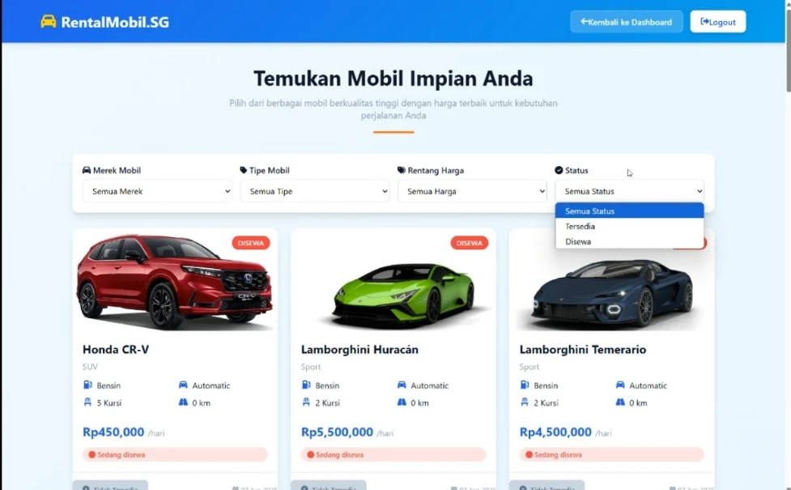

This is an archived PHP and MySQL academic build, not a live rental service.
The source review informs the story; the original application and database were
not rerun. Henry confirmed the captured records are simulated coursework data
and approved their display. Uploaded receipts, accounts, contacts, the database
and full report stay private. A walkthrough request stays available without
inventing a live demo.

The three WebPs total about 110 KiB, with unchanged framing and source hashes in
[`capture.json`](public/assets/projects/rentalmobil-sg/capture.json). The optional
[`prepare-rental-captures.mjs`](scripts/prepare-rental-captures.mjs) only accepts
those exact reviewed images and requires explicit simulated-data confirmation;
private source inputs are not required to run this
portfolio.

### Inside POS Z Shoes

The POS case study follows stock, sales and reporting through three inspectable
desktop screenshots. It explains size-aware stock checks, refunds versus
exchanges, and role-specific workspaces in the C# WinForms course build.

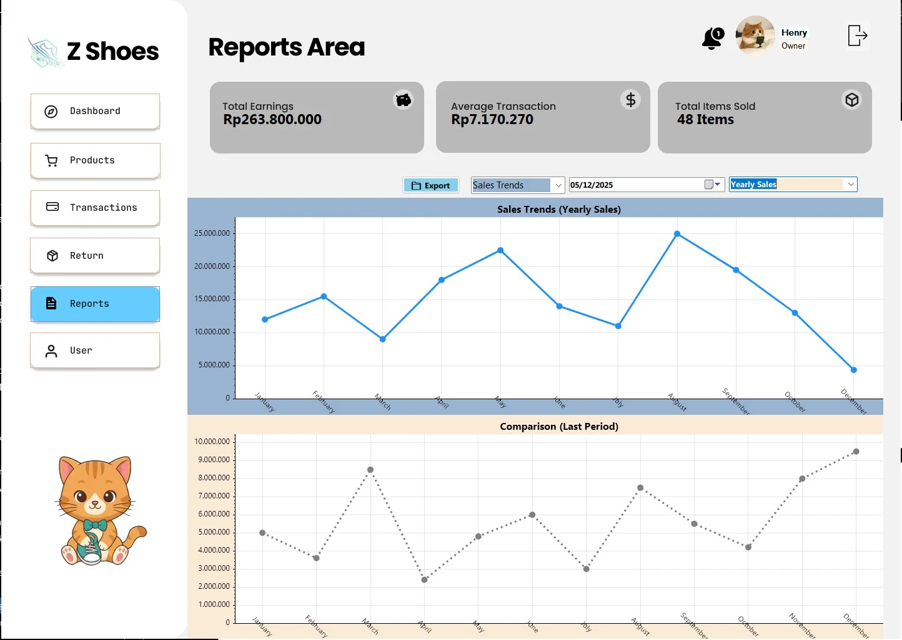

I built the application independently; classmates helped prepare the sample
data. These are archived screenshots from the course report with simulated
records, approved for portfolio display. The original product-photo placeholders
remain visible; this is not a new runtime recording, hosted demo or claim of
commercial use. The full report, student IDs, account lists and database stay
outside the portfolio.

The three WebPs total about 305 KiB. Their source hashes and processing are in
[`capture.json`](public/assets/projects/pos-z-shoes/capture.json). The optional
[`prepare-pos-captures.mjs`](scripts/prepare-pos-captures.mjs) converts only three
selected report images, after explicit simulated-data confirmation. Building
the portfolio does not require the original report or POS installation.

## Client Work

**Y-Ventures Chatbot** connects researched vendor information with event-planning conversations through n8n. Filtering, price sorting, and quote calculation support the matching workflow. Solo implementation by Henry.

**Soreva Autonomous Content** connects discovery, editorial generation, branded media, review, scheduling, and controlled publishing. Henry built the automation; Vieri contributed the prototype account. Private material stays outside this repository.

## Credentials

The portfolio includes **37 certificates, badges, and participation records**, with five featured records shown first. **Google Student Ambassador, Class of 2026** leads the selection, alongside Google/Gemini learning, Dicoding coursework, competitions, and workshops. The latest additions cover cloud networking, data lakes, BigQuery, load balancing, Prometheus, machine learning APIs, and September 2026 Arcade activities. Records retain the type and date supported by their artwork; a skill badge is not presented as a professional certification.

<p align="center">
  <a href="public/assets/certificates/source/google-student-ambassador.pdf">
    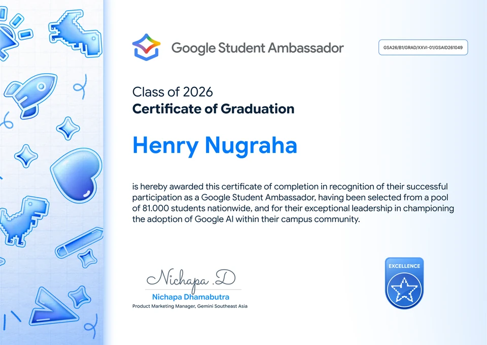
  </a>
</p>

<table>
  <tr>
    <td width="50%" align="center">
      <a href="public/assets/certificates/previews/gemini-certified-educator.png">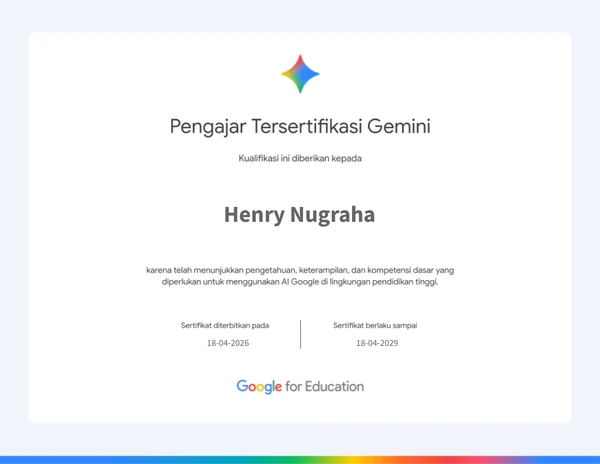</a><br />
      <strong>Gemini Certified Educator</strong><br />Google for Education
    </td>
    <td width="50%" align="center">
      <a href="public/assets/certificates/previews/dicoding-oop.png">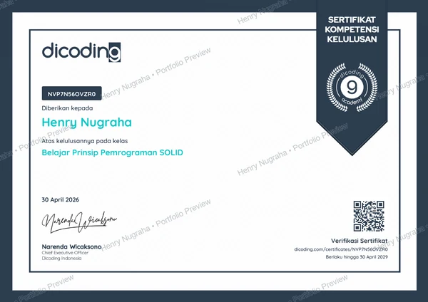</a><br />
      <strong>Belajar Prinsip Pemrograman SOLID</strong><br />Dicoding course completion
    </td>
  </tr>
</table>

Records retain their issuer and type, with full-size images and PDF previews where available. Course completions, badges, and professional certifications remain distinguishable. All current public copies, including these README images, carry a baked-in **Henry Nugraha • Portfolio Preview** watermark. Unmarked masters are private. Watermarks discourage reuse; they cannot prevent screenshots or retract copies and Git history published earlier.

## Built With

**Next.js · React · TypeScript · Three.js · Motion · GSAP · Lenis**

The spacecraft, orbital motion, project sculptures, and deep-space atmosphere are authored for this experience. Real project marks and original credential artwork anchor the visual world.

## Run Locally

```sh
npm ci
npm run dev
```

Open the local address printed by Next.js. For verification: `npm test`, `npm run typecheck`, and `npm run build`. Browser checks live in `tests/`; `npm run test:spacecraft-entry` checks the first UFO/scout encounter after arrival, Skip Intro, session return, and re-enabling motion.

This portfolio is **live and actively being developed** at [henry-nugraha.pages.dev](https://henry-nugraha.pages.dev/), hosted on Cloudflare Pages. The project and credential libraries, four-state personal portrait, and technology-to-credentials scroll chapter are available. Home uses selected previews instead of repeated project lists or a full credential archive. The portrait choreography and StarGod identity remain open to refinement.

### Cloudflare Pages

The site does not need a Next.js server, Workers adapter, database or image service.
Its interactive scenes run in the browser; all ten project details, the libraries,
404 page, sitemap, robots file and social-preview image are exported at build time.
Normal `npm run build` / `npm start` remain available for server-based local QA.

Production builds automatically from pushes to this repository's `main` branch.
The Cloudflare GitHub installation is limited to this portfolio repository.
Automatic preview deployments from other branches are disabled.
The first production deployment was verified on 16 October 2026 with these settings:

| Setting | Value |
| :-- | :-- |
| Framework preset | Next.js (Static HTML Export) |
| Production branch | `main` |
| Root directory | Repository root |
| Build command | `npm run build:pages` |
| Output directory | `out` |
| `NEXT_PUBLIC_SITE_URL` | `https://henry-nugraha.pages.dev` |
| `NODE_VERSION` | `24.15.0` |

Set the public origin for both production and preview build environments. Preview
builds should still use the production origin for canonical URLs. The build refuses
missing, localhost, HTTP and path/query-based origins. The Pages project is
`henry-nugraha`; no purchased domain or paid hosting is required. Earlier local
verification used `https://stargod.example`; never upload that test-origin output.

To verify an export locally in PowerShell:

```powershell
$env:NEXT_PUBLIC_SITE_URL = "https://henry-nugraha.pages.dev"
npm run build:pages
npm run test:pages -- --regression
```

The browser checks use installed Chrome in an isolated context (`CHROME_PATH` can
override its location). They start and close a loopback-only static file server;
they do not deploy, contact Cloudflare or send messages. This approximates static
routing and media serving, not Cloudflare's edge runtime. Repeat the URL, video,
preview-image and 404 checks on the actual host after deployment.

Cloudflare Pages currently sends the complete file with HTTP 200 for range
requests, rather than HTTP 206, as documented in [Serving Pages](https://developers.cloudflare.com/pages/configuration/serving-pages/#behavior).
The current Polara clip is approximately 629 KiB and was played through its ending
on the public host. The local test server's range support is not a claim about the
CDN; reconsider media delivery before adding long or large recordings.

The export check enforces the current Pages Free limits of 20,000 files and 25 MiB
per file, verifies copied public assets and all 85 watermarked derivatives, and
rejects private/runtime folders. The current output is about 45 MiB overall; its
largest file is a 6.9 MiB full-size certificate, loaded on inspection rather than
as a catalog thumbnail. `npm run check:pages` repeats this audit without building.

The wrapper also supplies verified dot-separated navigation aliases for Next
16.3.6's Windows segment-export naming. This is a no-op for already-correct Linux
output; it never modifies Next's installed code. Keep using the wrapper rather than
calling `next build` directly for Pages, and reevaluate this compatibility step when
upgrading Next. `_headers` gives the extensionless social image its PNG media type.
Keep `404.html`; do not add an SPA catch-all redirect or publish anything except
`out`. Public credential copies stay watermarked; private masters are not needed.

Hosting references: [Next.js static exports on Pages](https://developers.cloudflare.com/pages/framework-guides/nextjs/deploy-a-static-nextjs-site/),
[Pages limits](https://developers.cloudflare.com/pages/platform/limits/), and
[static routing](https://developers.cloudflare.com/pages/configuration/serving-pages/).

### Reading Routes

| Route | Contents |
| :-- | :-- |
| `/` | The interactive three-galaxy journey |
| `/projects` | Ten projects; category and text filters |
| `/projects/[slug]` | A shared detail page for each project |
| `/credentials` | Watermarked previews of all 37 learning records |

Content lives in `content/`; catalog pages and orbital reading actions share those records. Reading pages share one quiet volumetric nebula and distant-star field, without the project-map or cinematic scenes. Home and library backgrounds use a bounded pixel budget, with two conservative resolution adjustments after sustained frame pressure. Project planets, the maker orbit, text and controls keep their own resolution. Motion pauses when hidden and stays still with reduced motion; a dark fallback keeps content readable without WebGL. The maker's small 3D scene exists only during its visible technology phase, with the upper galaxy animation paused; it releases its renderer before credentials and Contact. Shared typography roles keep reading sizes and spacing consistent.

Certificate lists and viewers use permanently watermarked derivatives. `scripts/credential-watermarks.py` exports images, thumbnails, flattened PDF previews and README copies from private local masters, using Pillow, pypdf, ReportLab and Poppler. Regeneration requires those private masters; they are intentionally absent from a public clone. `node scripts/credential-thumbnails.mjs` can resize verified public copies, refusing changed/unreviewed input. The public checksum manifest and unit checks guard against accidentally replacing marked files. These checks ensure consistency, not copy protection.

Published portrait derivatives live in `public/assets/portrait/`. `node scripts/portrait-exports.mjs` recreates them from four selected local masters in the Git-ignored `assets/henry/portraits/` folder. Source photographs and generation drafts are private and are not required to run the public clone.

Route and accessibility checks: `npm run test:libraries`; entrance and exploration window: `npm run test:arrival`; galaxy integration: `npm run test:galaxies`; portrait choreography: `npm run test:maker`; rotation and reading continuity: `npm run test:maker-continuity`; background pixel budgets and controlled-load checks: `npm run test:sky-quality`.

Local-star capture shaders: `npm run test:gravity-field` uses isolated real WebGL without a running site. Contact choreography: `npm run test:closing` checks the complete scene, recurring dust and planets, and scroll reversal against `PORTFOLIO_URL` (default `http://localhost:3002/`).

Contact navigation: `npm run test:contact-path` checks arrivals from catalogs and project details, repeated Home links, direct fragments, browser Back and the WhatsApp-to-Email keyboard order across responsive layouts and motion preferences.

Each project detail ends with WhatsApp and email actions for discussing a similar
project. Drafts name the project and follow the selected language; visitors review
and send them themselves. Existing private-demo requests also carry context, while
live-product and repository links remain unchanged. No form submission, message
storage or automatic sending is involved. `npm run test:project-contact` tests
these paths with external WhatsApp navigation intercepted locally.

<details>
<summary>About the README visuals</summary>

Public media is stored in this repository. The animated tour and stills are captured from the running portfolio. Certificate images are resized from genuine records with an added ownership watermark; issuer text and achievements are not generated. The still image is also supplied for reduced-motion readers.

To refresh the preview after an interface change, start the portfolio on port 3002 and run:

```sh
node scripts/capture-readme.mjs
python scripts/encode-readme.py
```

The capture uses the installed Playwright package and an isolated Chrome instance. Set `PORTFOLIO_URL` or `CHROME_PATH` for a different local address or Chrome executable. Encoding requires Pillow. Raw captures stay in the ignored `test-results/readme-frames/` directory; only the optimized exports in `public/assets/readme/` are published. Animated WebP preserves the nebula colors; GIF is the fallback. Their export budgets are two and six megabytes respectively, and the GIF uses one shared palette to avoid color flicker.

</details>

## Contact

[LinkedIn](https://www.linkedin.com/in/nugrahahenry/) · [GitHub](https://github.com/nugrahahenry) · [Instagram](https://instagram.com/hnry.dev) · [Email](mailto:henrynugraha1210@gmail.com) · [Start a Project](https://wa.me/6289513595554)

---

Internal planning, credential masters, and runtime data stay private. Project artwork and watermarked credential previews are included for portfolio presentation. Keep `NEXT_PUBLIC_SITE_URL` aligned with the production origin when changing hosts.
